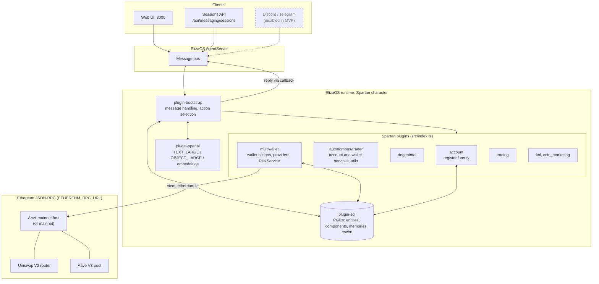
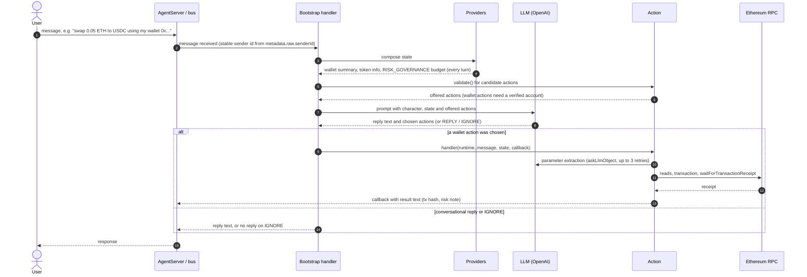
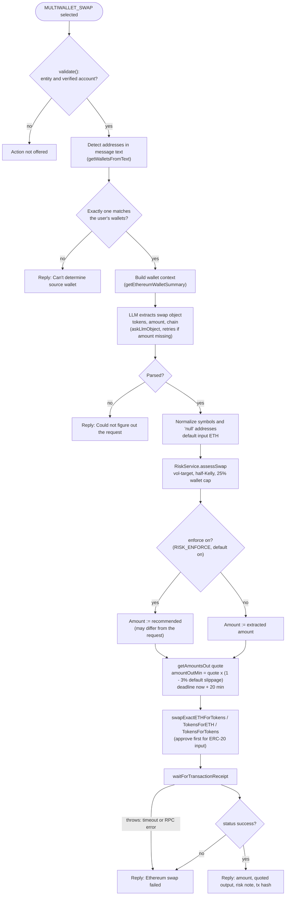
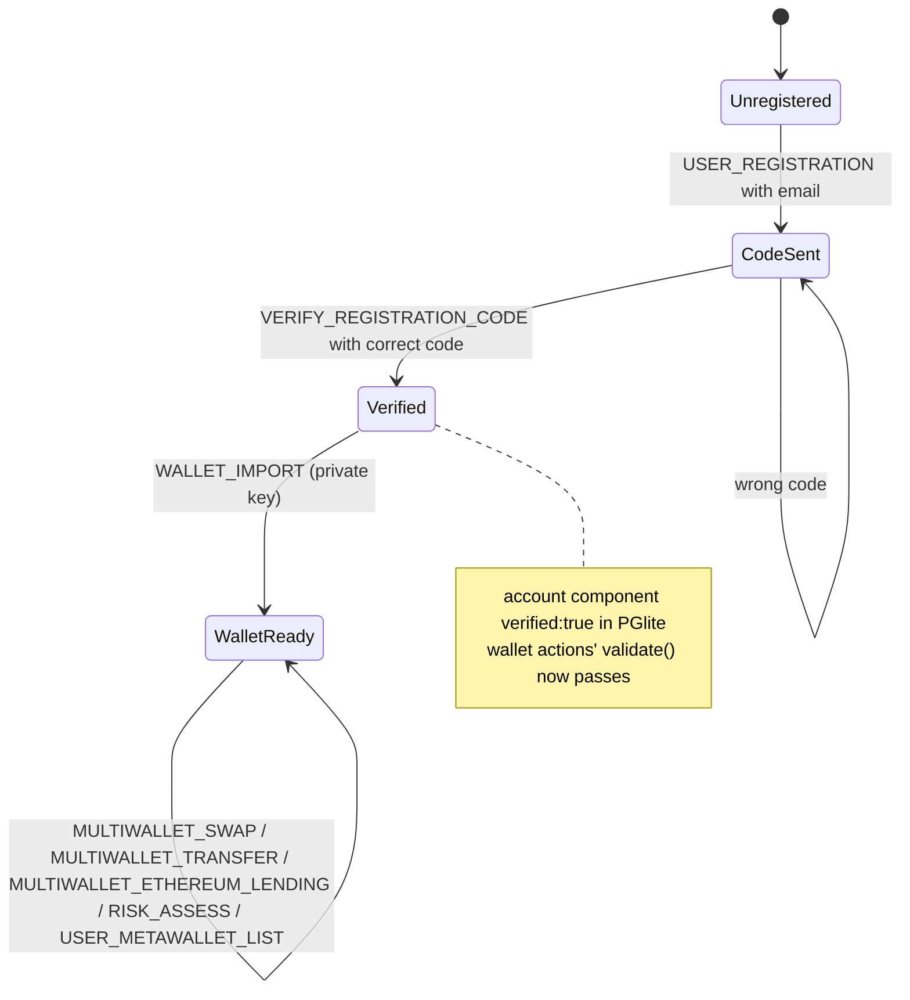
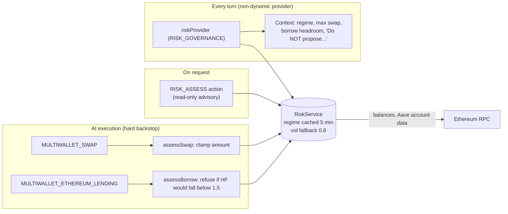

# Spartan flow diagrams (Ethereum MVP)

Visual companion to [ARCHITECTURE.md](ARCHITECTURE.md), [PHASE3_ACTIONS.md](PHASE3_ACTIONS.md) and
[PHASE4_2_AGENT_RISK.md](PHASE4_2_AGENT_RISK.md). The diagrams follow the code on `ethereum-amm-agent`
(`src/index.ts`, `src/plugins/multiwallet/**`, `src/plugins/autonomous-trader/utils.ts`) and the run setup
verified in the phase documents: the web UI or Sessions API on `:3000`, OpenAI models, PGlite via
`plugin-sql`, and an Anvil mainnet fork as the Ethereum RPC. Discord, Telegram, Solana and Jupiter are
disabled in the Ethereum MVP character and appear dashed.

Diagrams are Mermaid and render on GitHub. Following the CSC490 architecture-diagram guidance (Lecture 3),
each one shows the system through one lens, names the actual components, and should be specific enough
to build from:

| Section | Lens | Question it answers |
|---|---|---|
| 1. Runtime overview | High level | Which processes, plugins and external systems exist, and how do they connect? |
| 2. One chat turn | Mid level (sequence) | What happens between a user message and an on-chain transaction? |
| 3. `MULTIWALLET_SWAP` | Component level | What exactly does the swap handler check, compute and send? |
| 4. Onboarding | User flow | What must a user do before wallet actions become available? |
| 5. Risk layer | Component level | Where is risk advisory, and where is it enforced? |

Evidence status: sections 1, 2 and 4 match the flows exercised live in [PHASE2_AGENT_CHAT.md](PHASE2_AGENT_CHAT.md)
and [PHASE3_ACTIONS.md](PHASE3_ACTIONS.md). Sections 3 and 5 are read from the code; the risk path is verified in
[PHASE4_2_AGENT_RISK.md](PHASE4_2_AGENT_RISK.md). The internals of `plugin-bootstrap` in section 2 are summarized at
the level the Spartan code depends on (providers, `validate()`, model selection, handler, callback). They are
not a line-by-line trace of the ElizaOS core.

Legend for section 1: solid boxes are enabled in the Ethereum MVP. Dashed boxes are present in the code or
character but disabled. Cylinders are data stores.

## 1. Runtime overview

Concrete values from the verified setup: server port `3000`; `OPENAI_LARGE_MODEL=gpt-4o`;
`ETHEREUM_RPC_URL=http://127.0.0.1:8545` pointing at the Anvil fork; PGlite state under `packages/spartan/.eliza`.
Spartan runs as `packages/spartan` inside the ElizaOS `develop` monorepo ([SETUP_FROM_SCRATCH.md](SETUP_FROM_SCRATCH.md)).

## 2. One chat turn: message to action

Providers run before the model chooses. An action is only offered if its `validate()` passes. For
wallet actions, that requires a registered and verified account (see section 4). The model can still
reply conversationally or choose `IGNORE` even when an action is available ([PHASE3_ACTIONS.md](PHASE3_ACTIONS.md) §4).

## 3. `MULTIWALLET_SWAP` on Ethereum

From `src/plugins/multiwallet/actions/act_wallet_swap.ts` and `swapEthereumExactIn` in
`src/plugins/multiwallet/utils/ethereum.ts`. The Solana branch is omitted (disabled in the MVP).

Notes:
- **What the user can control.** The user's request becomes one extracted object: tokens, amount and an optional chain. A minimum output, a reserve to keep, or a multi-step goal has no field in that object. Those constraints rely on the model's reply and on later turns.
- **Risk clamping.** With enforcement on, the executed amount can be smaller than requested. The reply states the executed amount and the risk note.
- **Slippage.** Slippage protection is a fixed 3% `amountOutMin` derived from the router quote at send time.
- **Failures after sending.** Every exception after the transaction is sent is reported as `Ethereum swap failed`, including a receipt wait that times out or an RPC error. The reply copies the library's error text, which may contain the hash. The handler itself records no submission and does not check the receipt again. A transaction that later mines is therefore reported as a failure.

## 4. Account and wallet onboarding

Wallet actions only become available after this sequence (verified in [PHASE3_ACTIONS.md](PHASE3_ACTIONS.md) §2).

## 5. Risk layer: advisory every turn, enforced at execution

